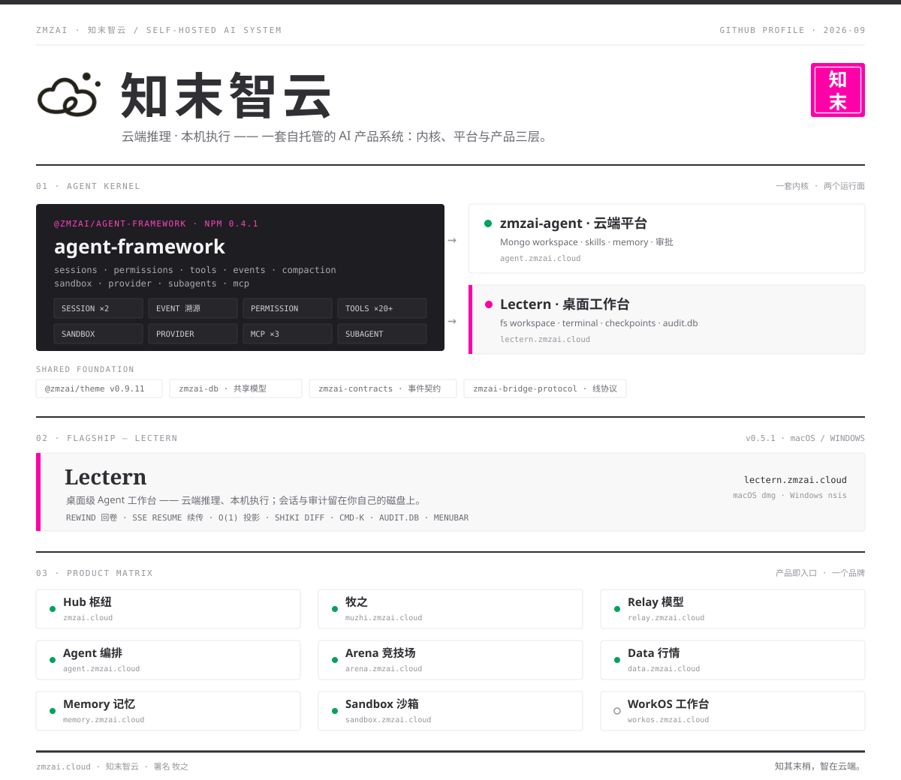

<p align="center">
  <sub>知末智云 · 自托管 AI 产品系统</sub>
</p>

<h1 align="center">zmzai · 知末智云</h1>

<p align="center">
  <code>Agent Framework</code> · <code>Desktop Workbench</code> · <code>Sandbox</code> · <code>MCP</code> · <code>Knowledge Product</code>
</p>

<p align="center">
  <a href="https://zmzai.cloud">zmzai.cloud</a>
  ·
  <a href="https://lectern.zmzai.cloud">lectern.zmzai.cloud</a>
  ·
  <a href="https://github.com/zmzai-cloud">@zmzai-cloud</a>
  ·
  <a href="mailto:mifindxuan@gmail.com">mifindxuan@gmail.com</a>
</p>

---

<p align="center">
  
</p>

> 知其末梢，智在云端。

我在做一套可独立部署的 AI 产品系统。它长成了三层：**内核**（agent-framework、theme、contracts）负责会话、权限、工具与协议；**平台**（Relay、Auth、Sandbox、Billing）负责模型、身份、执行与结算；**产品**（Lectern、Agent、Arena、牧之、Data、Memory）把能力交付到桌面和浏览器。

重点不是把功能堆在一个 demo 里，而是把链路跑成闭环：用户能登录、调用、执行、留痕，服务之间能校验身份、结算额度、恢复状态。

## 整体框架 —— 一套内核，两个运行面

[zmzai-framework](https://github.com/zmzai-cloud/zmzai-framework) 是整个系统的 coding agent 内核，以 npm 包 [**@zmzai/agent-framework**](https://www.npmjs.com/package/@zmzai/agent-framework)（`v0.4.1`）发布，从 zmzai-agent 经 subtree split 抽出独立演进，git 历史完整。云端平台与桌面工作台共用同一份会话、权限与工具协议——差别只在装配：一边接 Mongo workspace，一边接本机文件系统。

| 能力 | 说明 |
| --- | --- |
| sessions | jsonl / SQLite 双存储，跨会话恢复 |
| events | 事件溯源 + seq 重放，断线续传的底座 |
| permissions | ruleset LAST-match + 审批档位 |
| tools | read / write / edit / glob / grep / bash / terminal / git / apply_patch / web … |
| sandbox | 子进程沙箱：程序白名单 + 快照 + 产物回写 |
| provider | relay / OpenAI 兼容，failover + reasoningEffort |
| compaction | 投影式压缩，不改历史 |

两个运行面，同一份内核：

- **[zmzai-agent](https://github.com/zmzai-cloud/zmzai-agent) · 云端平台** — Mongo workspace、skills、memory 召回、任务审批
- **[zmzai-lectern](https://github.com/zmzai-cloud/zmzai-lectern) · 桌面工作台** — 本机 fs workspace、terminal、checkpoints、审计

### 系统怎么运行

一次请求从工作台（Lectern 或 zmzai-agent）进入内核，经 Relay 选择模型并完成额度结算；执行落在两条安全边界之一——云端 Sandbox 容器，或经 Bridge 反向隧道下发到用户本机、由用户审批后执行。云端执行和本机执行互不越界，共享的 Auth、contracts、theme 与 bridge-protocol 让所有产品保持一致。

### 共享底座

| 仓库 | 职责 |
| --- | --- |
| [zmzai-theme](https://github.com/zmzai-cloud/zmzai-theme) | 全品牌设计系统 [@zmzai/theme](https://www.npmjs.com/package/@zmzai/theme) `v0.9.11` · 53 组件 |
| [zmzai-db](https://github.com/zmzai-cloud/zmzai-db) | 产品线共享 Mongoose 模型 |
| [zmzai-contracts](https://github.com/zmzai-cloud/zmzai-contracts) | 跨服务事件契约（usage.recorded / span.closed） |
| [zmzai-bridge-protocol](https://github.com/zmzai-cloud/zmzai-bridge-protocol) | 桌面端 ↔ 云端线协议 |

## Lectern —— 桌面 Agent 工作台

[lectern.zmzai.cloud](https://lectern.zmzai.cloud) · [源码](https://github.com/zmzai-cloud/zmzai-lectern) · `v0.5.1`

**云端推理，本机执行。** Web 与 Electron 加载同一套 Next.js 页面：推理走 Relay，文件读写、命令执行、git 操作在本机沙箱完成，会话与审计留在你自己的磁盘上。

| 能力 | 说明 |
| --- | --- |
| 会话回卷 | 时间轴拖回任意一轮之前，事件溯源截断、被切消息不复活 |
| 断点续传 | SSE 带序号，断点重放 + 指数退避重连 |
| 增量投影 | 每事件 O(1) 折叠成消息树，长会话照样流畅滚动 |
| Diff 审阅 | 右侧看板实时呈现本轮变更，Shiki 按需高亮 |
| 命令面板 | Cmd-K / Cmd-P / Cmd-Shift-F 三模式，键盘优先 |
| 权限审计 | 每次写文件、执行命令都落独立 audit.db |
| 托盘常驻 | 菜单栏看运行状态，任务完成发系统通知 |

下载见 [lectern.zmzai.cloud](https://lectern.zmzai.cloud)：macOS dmg（Apple Silicon）· Windows nsis 安装器。

## 产品线

| 产品 | 入口 | 状态 | 方向 |
| --- | --- | --- | --- |
| Hub 枢纽 | [zmzai.cloud](https://zmzai.cloud) | LIVE | 品牌首页与产品索引 |
| Lectern 工作台 | [lectern.zmzai.cloud](https://lectern.zmzai.cloud) | LIVE | 桌面 Agent 工作台 |
| Agent 编排 | [agent.zmzai.cloud](https://agent.zmzai.cloud) | LIVE | 从对话开始完成真实任务 |
| Relay 模型 | [relay.zmzai.cloud](https://relay.zmzai.cloud) | LIVE | 模型目录、额度钱包与服务间 API |
| Arena 竞技场 | [arena.zmzai.cloud](https://arena.zmzai.cloud) | LIVE | AI 投研竞技场 — 回测、排行榜、对决擂台 |
| 牧之 | [muzhi.zmzai.cloud](https://muzhi.zmzai.cloud) | LIVE | 署名站 — 博客 + 付费知识体系 |
| Data 行情 | [data.zmzai.cloud](https://data.zmzai.cloud) | LIVE | A 股 + 加密货币统一行情服务 |
| Memory 记忆 | [memory.zmzai.cloud](https://memory.zmzai.cloud) | LIVE | Tome 卷帙 — hindsight 长期记忆管理台（暂未开源） |
| Sandbox 沙箱 | [sandbox.zmzai.cloud](https://sandbox.zmzai.cloud) | LIVE | 为 Agent 提供统一受限执行 |
| WorkOS 工作台 | [workos.zmzai.cloud](https://workos.zmzai.cloud) | BUILDING | AI 时代的个人工作面（视觉底盘已上线） |

## 仓库全览

<details>
<summary><b>zmzai-cloud · 21 个仓库，三层结构</b></summary>

**产品（8）**

| 仓库 | 职责 |
| --- | --- |
| [zmzai-lectern](https://github.com/zmzai-cloud/zmzai-lectern) | 桌面 Agent 工作台（Web / Electron 同构） |
| [zmzai-lectern-site](https://github.com/zmzai-cloud/zmzai-lectern-site) | Lectern 官网与下载页 |
| [zmzai-agent](https://github.com/zmzai-cloud/zmzai-agent) | 智能体运行时与任务编排层 |
| [zmzai-arena](https://github.com/zmzai-cloud/zmzai-arena) | AI 投研竞技场 — 仿真引擎 + 排行榜 + 赛季联赛 |
| [zmzai-data](https://github.com/zmzai-cloud/zmzai-data) | 统一行情服务（A 股 + 加密日线 / 报价） |
| [muzhi](https://github.com/zmzai-cloud/muzhi) | 牧之署名站 — 博客 + 付费知识体系 |
| [zmzai-cloud](https://github.com/zmzai-cloud/zmzai-cloud) | 产品矩阵主站与工作区入口 |
| [zmzai-workos](https://github.com/zmzai-cloud/zmzai-workos) | 个人工作台方向（产品占位 / 视觉底盘） |

**内核与协议（5）**

| 仓库 | 职责 |
| --- | --- |
| [zmzai-framework](https://github.com/zmzai-cloud/zmzai-framework) | @zmzai/agent-framework — sessions / permissions / tools / events |
| [zmzai-theme](https://github.com/zmzai-cloud/zmzai-theme) | @zmzai/theme — 全品牌设计系统，53 组件 |
| [zmzai-db](https://github.com/zmzai-cloud/zmzai-db) | 共享数据库模型与认证原语 |
| [zmzai-contracts](https://github.com/zmzai-cloud/zmzai-contracts) | 生态共享事件契约 |
| [zmzai-bridge-protocol](https://github.com/zmzai-cloud/zmzai-bridge-protocol) | 桌面端 ↔ 云端 wire contract |

**平台设施（8）**

| 仓库 | 职责 |
| --- | --- |
| [zmzai-relay](https://github.com/zmzai-cloud/zmzai-relay) | 模型目录、额度钱包与服务间 API |
| [zmzai-auth](https://github.com/zmzai-cloud/zmzai-auth) | 产品线单点登录服务 |
| [zmzai-sandbox](https://github.com/zmzai-cloud/zmzai-sandbox) | 受限代码执行层与 Sandbox Runner |
| [zmzai-billing](https://github.com/zmzai-cloud/zmzai-billing) | 计量计费中台 — usage 账本 + entitlement + Paddle |
| [zmzai-bridge](https://github.com/zmzai-cloud/zmzai-bridge) | 云端桥接端点 — 反向隧道终结 + 会话路由 |
| [zmzai-client](https://github.com/zmzai-cloud/zmzai-client) | Electron 桌面桥 — 本机执行端点 + 审批 + 审计 |
| [zmzai-status](https://github.com/zmzai-cloud/zmzai-status) | 全站状态页 — 健康探测 + 翻转告警 |
| [.github](https://github.com/zmzai-cloud/.github) | 组织主页介绍 |

**已部署、暂未开源**

| 项目 | 入口 | 说明 |
| --- | --- | --- |
| zmzai-memory（Tome 卷帙） | [memory.zmzai.cloud](https://memory.zmzai.cloud) | hindsight 长期记忆的管理台 — bank 浏览、搜索与权限 |
| hindsight | 内部 :8888 | 自部署的长期记忆引擎，memory 的上游 |

</details>

## 技术关注

```txt
AI Agent        Agent Framework  MCP
TypeScript      Node.js          Next.js / NestJS
Event Sourcing  SSE              Sandbox / RPA
Playwright      Browser Use      Developer Tools
Self-Hosting    Billing          Knowledge Product
```

---

<p align="center">
  <sub>zmzai.cloud · 知末智云 · 署名 牧之</sub>
</p>
