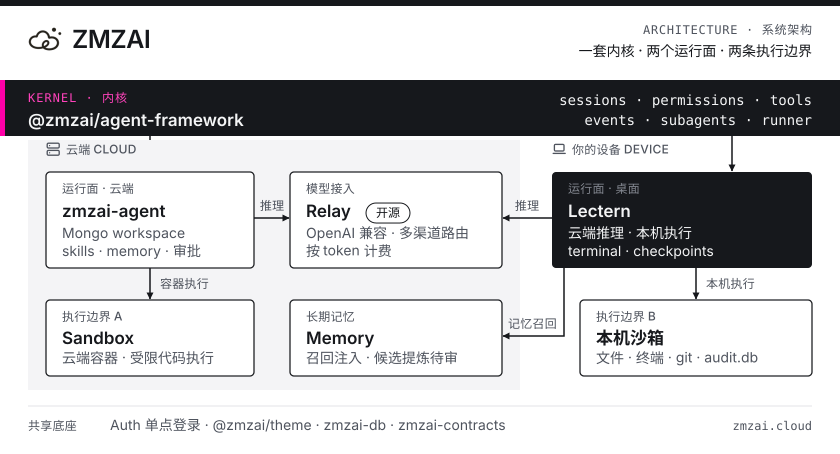

<p align="center">
  <sub>知末智云 · 自托管 AI 产品系统</sub>
</p>

<h1 align="center">zmzai · 知末智云</h1>

<p align="center">
  <code>Agent Framework</code> · <code>Desktop Workbench</code> · <code>Relay</code> · <code>Sandbox</code> · <code>MCP</code> · <code>Knowledge Product</code>
</p>

<p align="center">
  <a href="https://zmzai.cloud">zmzai.cloud</a>
  ·
  <a href="https://lectern.zmzai.cloud">lectern.zmzai.cloud</a>
  ·
  <a href="https://github.com/zmzai-cloud">@zmzai-cloud</a>
  ·
  <a href="mailto:mifindxuan@gmail.com">mifindxuan@gmail.com</a>
</p>

---

<p align="center">
  
</p>

> 知其末梢，智在云端。

我在做一套可独立部署的 AI 产品系统。它长成三层：**内核**（agent-framework、theme、contracts）负责会话、权限、工具与协议；**平台**（Relay、Auth、Sandbox、Billing）负责模型、身份、执行与结算；**产品**（Lectern、Agent、Arena、牧之、Data、Memory）把能力交付到桌面和浏览器。重点不是把功能堆在一个 demo 里，而是把链路跑成闭环：登录、调用、执行、留痕、结算、恢复。

## 正在做

- **[Relay](https://github.com/zmzai-cloud/relay)** — 自托管 LLM API 中转站 · OpenAI 兼容 · 多渠道路由 · 按 token 计费（已开源）
- **[Lectern](https://github.com/zmzai-cloud/zmzai-lectern)** — 桌面 Agent 工作台 · 云端推理，本机执行
- **[@zmzai/agent-framework](https://www.npmjs.com/package/@zmzai/agent-framework)** — coding agent 内核 · sessions / permissions / tools / events
- **[牧之](https://github.com/zmzai-cloud/muzhi)** — 自托管知识付费站与内容交付

产品矩阵与全部仓库 → **[@zmzai-cloud](https://github.com/zmzai-cloud)**

## 技术关注

```txt
AI Agent        Agent Framework  MCP
TypeScript      Node.js          Next.js / NestJS
Event Sourcing  SSE              Sandbox / RPA
Playwright      Browser Use      Developer Tools
Self-Hosting    Billing          Knowledge Product
```

---

<p align="center">
  <sub>zmzai.cloud · 知末智云 · 署名 牧之</sub>
</p>
